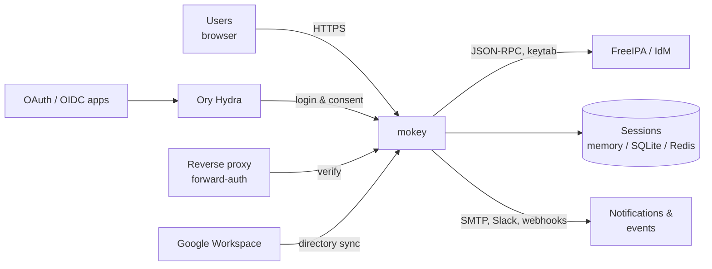
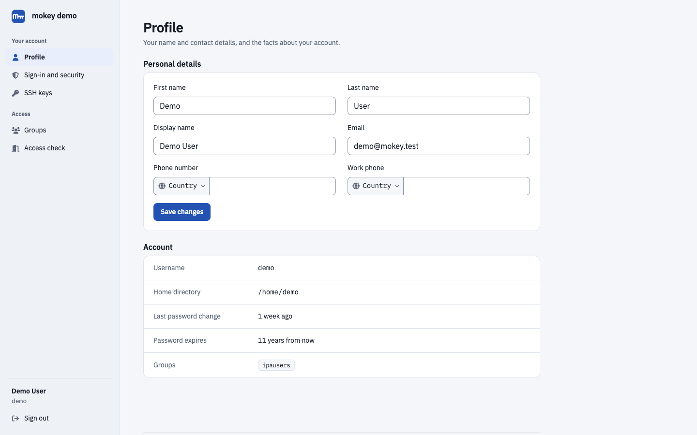
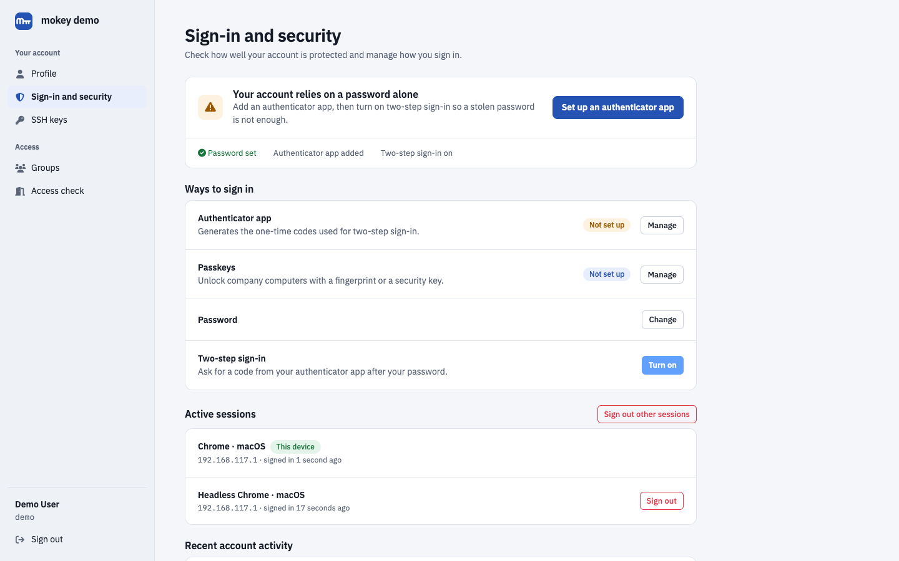
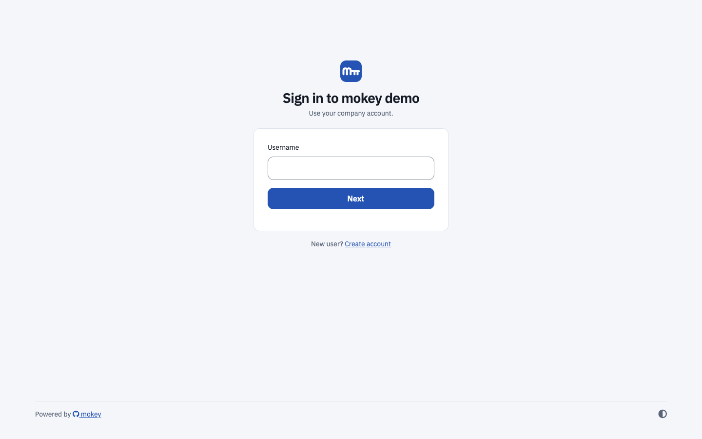
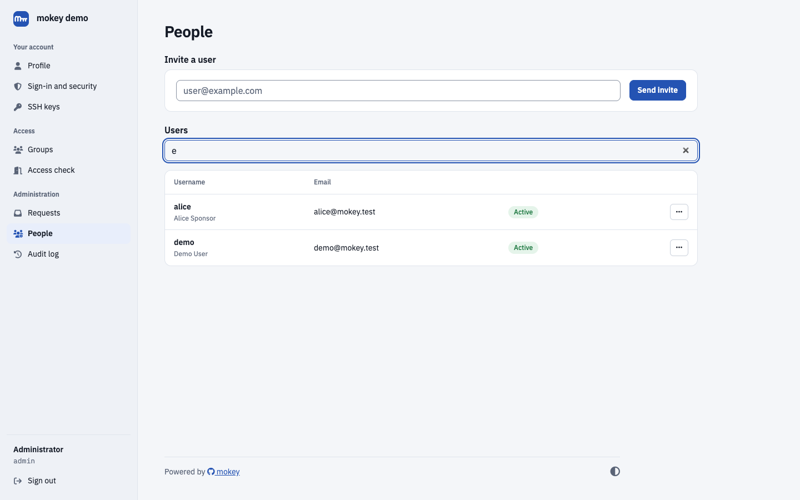

# mokey

**Account and access lifecycle for FreeIPA / Red Hat IdM.**

[](https://github.com/neverlless/mokey/actions/workflows/ci.yml)
[](https://github.com/neverlless/mokey/releases)
[](go.mod)
[](LICENSE)

mokey gives FreeIPA users a self-service portal for their own account, lets
group sponsors approve access requests, optionally for a limited time, and
signs people in to web apps: over OpenID Connect as the login and consent app
for Ory Hydra, or with forward-auth behind a reverse proxy. It can also keep
FreeIPA accounts in step with Google Workspace: joiners get an account,
leavers are locked. Admins get a helpdesk view and an audit log; other
systems get webhooks and a read-only JSON API.

FreeIPA stays the single store for users, groups and credentials. mokey talks
to the FreeIPA JSON-RPC API with a least-privilege service account, needs no
schema changes, and every new capability is off by default.

**Documentation: <https://neverlless.github.io/mokey/>**

## Why

- **FreeIPA has no self-service signup or password reset**, by design (see
  [the rationale](https://www.freeipa.org/page/Self-Service_Password_Reset)).
  mokey adds both as a separate application instead of a FreeIPA plugin.
- **Keep regular users out of the FreeIPA Web UI.** By default any
  authenticated user can browse every account there. mokey shows users
  *their own* account only; the Web UI and CLI stay with administrators.
- **Access decisions stay in FreeIPA.** Group membership, HBAC rules and
  member managers decide who gets in, for the portal and for the apps behind
  it.

## How it works



## Features

**Self-service** ([password reset](docs/guides/password-reset.md),
[signup](docs/guides/signup.md), [OTP](docs/guides/otp.md),
[passkeys](docs/guides/passkeys.md))

- Signup with email verification, optional admin approval and FreeIPA stage
  users; invitations
- Password change and reset, checked against the FreeIPA password policy and
  optionally Have I Been Pwned
- OTP tokens and two-step sign-in, with admin-approved recovery of a lost token
- Passkeys stored in FreeIPA (4.11+), usable for SSSD host logins
- SSH public keys, email change, subordinate IDs, active sessions and
  recent activity
- English, Dutch, Russian and Ukrainian, picked per request

**Access and approvals** ([groups](docs/guides/groups.md),
[Access page](docs/guides/access.md))

- Join and leave requests approved by group sponsors (FreeIPA member
  managers), in the sponsor's own FreeIPA session
- Time-bound membership with per-group limits, reminders, renewals and
  automatic removal
- Account expiry with reminders, and sponsors who renew the accounts they
  vouch for ([guide](docs/guides/account-lifecycle.md))
- Access page: the HBAC and sudo rules that apply to the user, and an
  hbactest simulator

**Sign-in for web apps** ([OIDC with Hydra](docs/guides/oidc-hydra.md),
[forward-auth](docs/guides/forward-auth.md),
[app catalog](docs/guides/app-catalog.md))

- Login, consent and logout app for Ory Hydra v2; clients limited to FreeIPA
  groups, consent revoked when a user loses the group
- Forward-auth for Traefik, ingress-nginx, Caddy, Envoy Gateway and Istio,
  gated by FreeIPA groups or an HBAC rule
- App catalog: users see the clients they can use and request access to the
  others
- SAML-only apps through Keycloak as a broker
  ([guide](docs/keycloak.md)), or mokey next to an existing OIDC provider
  ([guide](docs/companion/oidc-provider.md))

**Directory sync** ([guide](docs/guides/directory-sync.md))

- Google Workspace as an account source: creates, updates, locks and later
  deletes FreeIPA accounts, and maps Google groups to FreeIPA groups
- Dry run, a brake on mass locks and an admin page to review and apply;
  every change in the audit log and webhooks
- Runs inside the portal or as `mokey sync` from a CronJob or timer;
  replaces [google2ipa](https://github.com/neverlless/google2ipa)

**Admin and audit** ([helpdesk view](docs/guides/helpdesk.md))

- Admin pages for requests (sign-ups, OTP recovery, failed membership
  removals), people (invite, search, block and unblock) and the audit log
- Helpdesk lists of accounts with expiring or expired passwords, Kerberos
  lockouts and no recent activity

**Integrations** ([webhooks and JSON API](docs/guides/webhooks-api.md))

- Webhooks for every audit event, with a Slack format
- Read-only JSON API with bearer tokens
- Slack direct messages for account emails, Prometheus metrics, `/healthz`

**Operations** ([install](docs/install.md),
[configuration](docs/configuration.md))

- One Go binary; container images for amd64 and arm64 signed with cosign,
  with SBOMs and provenance
- Helm chart, COPR packages for Fedora, RHEL, Rocky Linux and AlmaLinux,
  deb/rpm, Ansible role
- Several replicas with Redis storage; background sweeps run on one replica
  per interval

## Screenshots

| Account | Security |
| --- | --- |
|  |  |

| Login | Admin panel |
| --- | --- |
|  |  |

## Project status

mokey is actively maintained and used in production. The core flows (login,
password change and reset, signup and email verification, invites, OTP tokens,
the admin panel) are covered by tests that drive the real application against
a simulated FreeIPA server, and by integration and browser tests against a
real one. The code base has been through a security audit
(`gosec`, `govulncheck`, `staticcheck` and a manual review of the
auth/session/token paths) with all high- and medium-severity findings fixed;
see [docs/security-audit-v1.6.md](docs/security-audit-v1.6.md). Planned work
is on the [roadmap](docs/ROADMAP.md).

mokey began as a fork of [ubccr/mokey](https://github.com/ubccr/mokey) and is
maintained independently; to move an upstream install, see
[Migrating from ubccr/mokey](docs/migrate-from-upstream.md).

Self-service password reset widens your attack surface. Read
[Operating mokey safely](SECURITY.md#operating-mokey-safely) before exposing
mokey to the internet.

## Try it

No FreeIPA server at hand? Start a throwaway one with mokey and a mail
catcher (Docker, about 10 minutes on first start):

```sh
docker compose -f examples/demo/compose.yml up -d
```

Then open <http://localhost:8866> and log in as `demo` / `demo-Passw0rd`.
Emails show up in Mailpit at <http://localhost:8025>. See
[examples/demo](examples/demo) for what to try and how to reset it.

## Quick start

1. **FreeIPA:** create the mokey service account and keytab as described in
   [Install](docs/install.md#1-create-the-service-account-in-freeipa).
2. **Config:** copy [mokey.toml.sample](mokey.toml.sample) and set at least
   `keytab`, the email settings and a persistent `[storage]` driver. Every
   option is in the [configuration reference](docs/configuration.md).
3. **Run** it one of these ways:

   ```sh
   # Kubernetes
   kubectl create secret generic mokey-config --from-file=mokey.toml
   kubectl create secret generic mokey-keytab --from-file=mokeyapp.keytab
   helm install mokey oci://ghcr.io/neverlless/charts/mokey \
     --set existingConfigSecret=mokey-config \
     --set existingKeytabSecret=mokey-keytab

   # Docker Compose
   docker compose -f examples/production/docker-compose.yml up -d

   # Fedora, RHEL, Rocky Linux, AlmaLinux
   sudo dnf copr enable neverlless/mokey && sudo dnf install mokey
   sudo systemctl enable --now mokey
   ```

## Install

Requires FreeIPA 4.6.8 or newer (or Red Hat IdM) and Linux on x86_64 or
aarch64; Redis and Ory Hydra v2 are optional. Package installs need a host
enrolled in FreeIPA.

- Container image: `ghcr.io/neverlless/mokey` (linux/amd64, linux/arm64)
- Helm chart: [charts/mokey](charts/mokey)
- COPR, deb, rpm and tar.gz: see [Install](docs/install.md) and the
  [releases page](https://github.com/neverlless/mokey/releases)
- Ansible role: [ansible/roles/mokey](ansible/roles/mokey)

Releases are signed with GPG and cosign:
[Verifying releases](docs/install.md#verifying-releases). Building from
source is described in [CONTRIBUTING.md](CONTRIBUTING.md#development).

## Documentation

Task guides, configuration reference, companion setups and comparisons with
other FreeIPA portals: <https://neverlless.github.io/mokey/>. Changes per
release are in the [ChangeLog](ChangeLog.md).

## Contributing

Bug reports, translations and pull requests are welcome. See
[CONTRIBUTING.md](CONTRIBUTING.md); report vulnerabilities privately as
described in [SECURITY.md](SECURITY.md).

## License

mokey is released under a BSD style license. See the LICENSE file.
