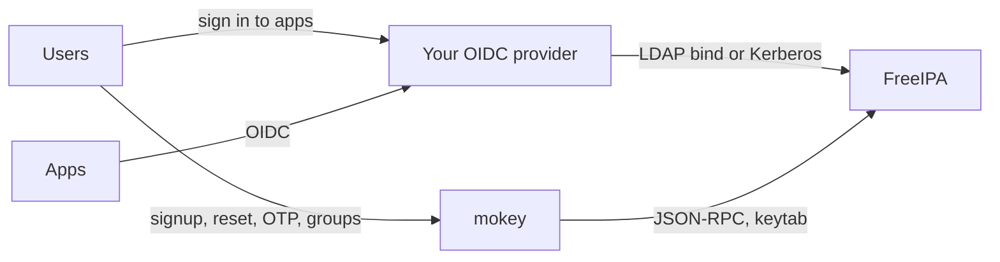

Already running an OpenID Connect provider for FreeIPA users, such as
Keycloak, Authentik, Dex or Zitadel? You do not need mokey's
[Hydra integration](../guides/oidc-hydra.md) to use mokey. Run it next to
your provider as the account lifecycle portal: the provider signs users in
against FreeIPA, mokey lets them create and repair the account they sign in
with.

FreeIPA is the only place both sides meet. Nothing is synced between mokey
and the provider.

## Who does what

| Task | Where |
| --- | --- |
| Sign in to apps, issue tokens, SSO session | OIDC provider |
| Which apps a user may open | OIDC provider (its own policies, usually on FreeIPA groups) |
| Signup, email verification, admin approval | mokey |
| Forgotten password, password change, expiry reminders | mokey |
| OTP tokens and passkeys stored in FreeIPA | mokey |
| SSH keys, group join/leave requests, "what can I access" | mokey |
| Admin panel: invites, approvals, OTP recovery, blocking | mokey |

## Setting it up

1. **Provider: authenticate against FreeIPA, read-only.** Connect the provider
   to FreeIPA by LDAP (`cn=users,cn=accounts,dc=example,dc=com`) or Kerberos,
   with a bind account that can only read. Make it look up users live in
   FreeIPA, or sync often, so new and changed accounts reach it quickly.
2. **Provider: send account tasks to mokey.** Turn off the provider's own
   registration, "forgot password" and credential-editing pages for FreeIPA
   users, or point their links at mokey (`https://mokey.example.com/signup`,
   `/auth/forgotpw`, `/password`, `/otp`). Otherwise there are two places to
   change a password. A password the provider writes with its own bind account
   is also treated by FreeIPA as an administrator reset, so it expires at
   once and the user has to change it again.
3. **mokey: no `[hydra]` section.** Install mokey as usual
   ([Install](../install.md)); set `email.base_url` and the `site.help_url`
   users should land on.
4. **OTP.** If the provider binds to FreeIPA's LDAP with the password, users
   with two-factor authentication on must type their password and OTP code
   together (`password123456`). That is FreeIPA's behaviour, not mokey's.
   Tokens enrolled in mokey then work at the provider. Second factors kept in
   the provider's own database (its TOTP or WebAuthn) are separate from
   FreeIPA's and do not apply to SSH or sudo.

## Things to watch

- **Locked and disabled accounts.** mokey's signup creates disabled (or
  staged) accounts until they are verified; make sure the provider refuses
  disabled FreeIPA users, which it does when it authenticates by LDAP bind.
- **Removing access.** Taking a user out of a group in mokey or FreeIPA
  changes what the provider sees at its next lookup. Existing provider
  sessions and tokens are the provider's to revoke.
- **Two logins.** Users sign in to mokey with the same FreeIPA password, but
  mokey keeps its own session; signing in to the provider does not sign them
  in to mokey.

For a Keycloak-specific setup where Keycloak only translates SAML and mokey
keeps the login page, see [mokey next to Keycloak](../keycloak.md).
