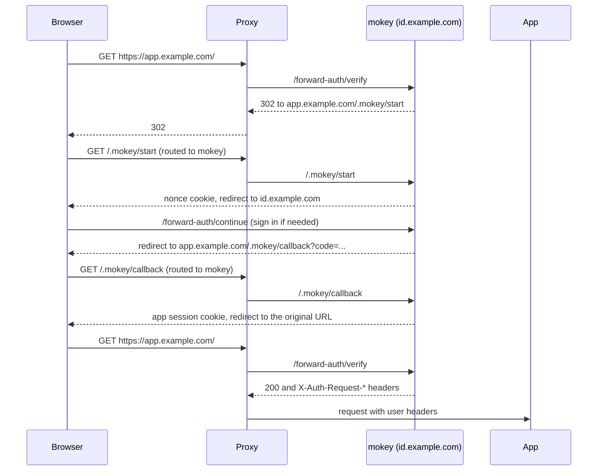

Many internal tools (dashboards, Kubecost, Prometheus, a wiki) have no login
of their own and no OIDC support. With forward-auth the reverse proxy in
front of the app asks mokey on every request: is this browser signed in, and
is the user allowed in? Access is decided by FreeIPA groups and, optionally,
an HBAC rule. People sign in once at mokey, with their password, OTP or
passkey, and open every protected app without another prompt.

Nothing is stored outside FreeIPA except short-lived app sessions in mokey's
storage. This is the oauth2-proxy / Authelia model, but the identity
provider is the FreeIPA account the user already has.

Forward-auth is off by default. For apps that speak OIDC, use
[OIDC with Hydra](oidc-hydra.md) instead.

## How it works



- Apps have their own session cookie (`__Host-mokey_fa`) on the app's own
  host. mokey's session cookie never leaves mokey's host.
- The proxy must send `/.mokey/*` on every app host to mokey. Everything
  else goes through the check.
- The code handed back to the app host is single-use, valid for 60 seconds,
  and only works in the browser that started the sign-in.

## Requirements

- Apps and mokey must be served over **HTTPS**. The app cookie uses the
  `__Host-` prefix, which browsers accept only on secure origins.
- mokey must be reachable from the proxy, and the proxy must route
  `https://<app host>/.mokey/` to mokey.
- Each protected host must be listed in mokey's configuration. Exact host
  names only, no wildcards.

> [!WARNING]
> Set `server.trusted_proxies` to the address of the proxy (or the
> Kubernetes pod range). Without it mokey ignores `X-Forwarded-*` headers,
> and every user behind the proxy shares one rate-limit key for
> `/forward-auth/continue`, where failed requests count (failed
> `/.mokey/*` requests count too): a few mistyped sign-ins can lock everyone
> out for the rate-limit window. Proxies that send
> no forwarded headers (Envoy, Istio, Cilium) still work through the `Host`
> header, but the rate-limit problem remains.

## Configuration

```toml
[server]
trusted_proxies = ["10.0.0.0/8"]

[forward_auth]
enabled = true
# mokey's own origin, as users reach it: https, no path
url = "https://id.example.com"

[[forward_auth.apps]]
host = "kubecost.example.com"
name = "Kubecost"
groups = ["finops", "admins"]
```

| Option | Default | Meaning |
| --- | --- | --- |
| `enabled` | `false` | Turn on the endpoints. |
| `url` | required | mokey's origin, for example `https://id.example.com`. Never derived from the request. |
| `session_idle` | `"8h"` | An app session ends after this long without a request. |
| `session_max` | `"24h"` | Longest an app session lasts, regardless of activity. |
| `recheck` | `"2m"` | How often a session's access is re-read from FreeIPA. |

Per app (`[[forward_auth.apps]]`):

| Option | Meaning |
| --- | --- |
| `host` | Exact, lowercase host name without scheme, port or path. Required, unique, not mokey's own host. |
| `name` | Shown on the sign-in and denied pages. |
| `groups` | Any of these FreeIPA groups admits the user; nested groups count. Empty means any signed-in user. |
| `hbac_service` | Optional. Also require that an HBAC `hbactest` for this service passes. |
| `hbac_host` | Host used for that test. Defaults to `host`. |

mokey refuses to start on an invalid configuration. A group that does not
exist in FreeIPA is logged as a warning at startup, naming the app and
group; the app stays configured, but nobody gets in through that group. The full reference is in
[Configuration](../configuration.md#forward_auth).

## What the app receives

On success mokey answers `200` and the proxy copies these headers onto the
request to the app:

| Header | Value |
| --- | --- |
| `X-Auth-Request-User`, `X-Auth-Request-Preferred-Username`, `Remote-User` | FreeIPA login name |
| `X-Auth-Request-Email`, `Remote-Email` | Mail address |
| `X-Auth-Request-Groups`, `Remote-Groups` | **All** the user's groups, comma-separated, nested ones included |
| `Remote-Name` | Display name |

> [!NOTE]
> The groups header lists every group the user belongs to, not only the
> ones that admit them to this app, so apps that map roles from group names
> work unchanged. It also means every protected app learns all group names
> of its users. Do not protect apps you do not trust with that.

`Remote-Groups`, `Remote-Email` and `Remote-Name` are sent too, but the
Traefik and nginx recipes below do not copy them; add the ones your app
reads.

Copy only the headers your app reads, and make sure the proxy overwrites
them: a client must never be able to send its own `X-Auth-Request-User`.
The recipes below do that.

## What users see

- Signed out: the browser is redirected to the app host's `/.mokey/start`,
  then to mokey to sign in. Login, OTP and expired-password steps work as
  usual and return to the app.
- Signed in but not allowed: a `403` page naming the app and the groups
  that admit people, with a link to request them (when group self-service
  is on).
- Requests that are not page navigations (XHR, API clients, `curl`) get a
  plain `401` instead of a redirect.
- `https://<app host>/.mokey/signout` ends the app session and shows a page
  on mokey's host with a button to also sign out of mokey. It cannot sign
  anyone out of mokey by itself, so a link to it is safe in an app's menu.

## Sessions and access changes

An app session has its own idle and maximum lifetime and does not depend on
mokey's session idling out. It is ended immediately when the user signs out
of mokey, revokes that session on the Security page, uses "sign out
everywhere", changes the password, or an admin disables the account.

Losing a group in FreeIPA takes effect within `recheck`. Time-bound group
membership that expires is removed by mokey's sweep and then reaches the
app within the sweep interval plus `recheck`. A request that is denied on
recheck ends the app session.

Forward-auth sign-ins and successful rechecks count as activity for the
admin Inactive list.

Audit events are written for sign-in decisions (`forward-auth sign-in`,
`forward-auth denied`), not per request. The Prometheus counter
`mokey_forward_auth_requests_total{result="allowed|denied|unauthenticated"}`
counts checks.

## Proxy recipes

Examples use `id.example.com` for mokey and `app.example.com` for the app.
In each one, three things must hold:

1. The proxy calls `/forward-auth/verify` on mokey for the app's requests.
2. `/.mokey/` on the app host goes to mokey without the check.
3. The proxy's address is in `server.trusted_proxies`, and the proxy
   overwrites the user headers from the check's response.

The `rd` value mokey receives must be the full original URL. Sending the
`Cookie`, `Accept` and `Sec-Fetch-Mode` request headers to the check matters
where a proxy sends only a fixed list of headers: without `Accept` mokey
cannot tell a page load from an API call and answers `401` instead of
redirecting.

### Traefik

Traefik sends `X-Forwarded-Proto`, `-Host` and `-Uri` itself. With the
Kubernetes CRDs:

```yaml
apiVersion: traefik.io/v1alpha1
kind: Middleware
metadata:
  name: mokey-auth
spec:
  forwardAuth:
    address: http://mokey.mokey.svc.cluster.local/forward-auth/verify
    authResponseHeaders:
      - X-Auth-Request-User
      - X-Auth-Request-Email
      - X-Auth-Request-Groups
      - Remote-User
---
apiVersion: traefik.io/v1alpha1
kind: IngressRoute
metadata:
  name: app
spec:
  entryPoints: [websecure]
  routes:
    - kind: Rule
      match: Host(`app.example.com`) && PathPrefix(`/.mokey/`)
      services:
        - name: mokey
          namespace: mokey
          port: 80
    - kind: Rule
      match: Host(`app.example.com`)
      middlewares:
        - name: mokey-auth
      services:
        - name: app
          port: 8080
  tls: {}
```

Traefik prefers the longer rule, so `/.mokey/` is matched first; add an
explicit `priority` if you have other overlapping rules. A cross-namespace
service reference needs `allowCrossNamespace` enabled in Traefik's
Kubernetes provider; otherwise create an `ExternalName` service next to the
route.

Without Kubernetes, the file-provider version used by mokey's own browser
tests is in `test/forward-auth/traefik.yml` in the repository.

### ingress-nginx

Annotate the app's Ingress to ask mokey, and add a second Ingress that
sends `/.mokey/` on the same host to mokey. ingress-nginx sends
`X-Original-URL` to the check, which mokey uses to rebuild the URL.

```yaml
apiVersion: networking.k8s.io/v1
kind: Ingress
metadata:
  name: app
  annotations:
    nginx.ingress.kubernetes.io/auth-url: "http://mokey.mokey.svc.cluster.local/forward-auth/verify"
    nginx.ingress.kubernetes.io/auth-signin: "https://$host/.mokey/start?rd=$scheme://$host$escaped_request_uri"
    nginx.ingress.kubernetes.io/auth-response-headers: "X-Auth-Request-User, X-Auth-Request-Email, X-Auth-Request-Groups, Remote-User"
spec:
  ingressClassName: nginx
  tls:
    - hosts: [app.example.com]
      secretName: app-tls
  rules:
    - host: app.example.com
      http:
        paths:
          - path: /
            pathType: Prefix
            backend:
              service:
                name: app
                port: { number: 8080 }
---
apiVersion: networking.k8s.io/v1
kind: Ingress
metadata:
  name: app-mokey
spec:
  ingressClassName: nginx
  tls:
    - hosts: [app.example.com]
      secretName: app-tls
  rules:
    - host: app.example.com
      http:
        paths:
          - path: /.mokey/
            pathType: Prefix
            backend:
              service:
                name: mokey
                port: { number: 80 }
```

Use the public `https://id.example.com/forward-auth/verify` as `auth-url` if
mokey is not reachable inside the cluster. nginx redirects to `auth-signin`
when mokey answers `401`; `auth-response-headers` overwrites any header the
client sent.

### Caddy

```caddyfile
app.example.com {
	handle /.mokey/* {
		reverse_proxy mokey:8866
	}
	handle {
		forward_auth mokey:8866 {
			uri /forward-auth/verify
			copy_headers X-Auth-Request-User X-Auth-Request-Email X-Auth-Request-Groups Remote-User
		}
		reverse_proxy app:8080
	}
}
```

Caddy sends the original method and URI as `X-Forwarded-Method` and
`X-Forwarded-Uri` and passes mokey's `302` to the browser. Add Caddy's
address to `server.trusted_proxies`.

### Envoy Gateway

A `SecurityPolicy` attached to the app's `HTTPRoute` calls mokey. Route
`/.mokey/` on the same host to mokey with a second `HTTPRoute` that has no
policy.

```yaml
apiVersion: gateway.envoyproxy.io/v1alpha1
kind: SecurityPolicy
metadata:
  name: app-mokey-auth
spec:
  targetRefs:
    - group: gateway.networking.k8s.io
      kind: HTTPRoute
      name: app
  extAuth:
    http:
      backendRefs:
        - name: mokey
          namespace: mokey
          port: 80
      path: /forward-auth/verify
      headersToBackend:
        - x-auth-request-user
        - x-auth-request-email
        - x-auth-request-groups
        - remote-user
    headersToExtAuth:
      - cookie
      - accept
      - sec-fetch-mode
      - x-requested-with
```

Envoy sends `Host` and the original path to the check; with `path` set, the
path becomes `/forward-auth/verify/<original path>`, which mokey strips to
rebuild the URL. A cross-namespace `backendRefs` needs a `ReferenceGrant`.

### Istio

Register mokey as an external authorizer in the mesh config, then protect
the app with an `AuthorizationPolicy` using the `CUSTOM` action.

```yaml
# in the istio ConfigMap (istio-system), key "mesh"
extensionProviders:
  - name: mokey
    envoyExtAuthzHttp:
      service: mokey.mokey.svc.cluster.local
      port: 80
      pathPrefix: /forward-auth/verify
      includeRequestHeadersInCheck: ["cookie", "accept", "sec-fetch-mode", "x-requested-with"]
      headersToUpstreamOnAllow: ["x-auth-request-user", "x-auth-request-email", "x-auth-request-groups", "remote-user"]
      headersToDownstreamOnDeny: ["location", "content-type"]
---
apiVersion: security.istio.io/v1
kind: AuthorizationPolicy
metadata:
  name: app-mokey
  namespace: app
spec:
  selector:
    matchLabels:
      app: app
  action: CUSTOM
  provider:
    name: mokey
  rules:
    - to:
        - operation:
            notPaths: ["/.mokey/*"]
```

Route `/.mokey/` on the app host to mokey with your `VirtualService` or
`HTTPRoute`. The policy attaches to the workload that serves the app, so
`/.mokey/` requests that the gateway sends to mokey are not checked.

### Gateway API ExternalAuth filter (experimental)

Gateway API has an `ExternalAuth` `HTTPRoute` filter, in the experimental
channel (`gateway:experimental`, so you need the experimental CRDs).
Support is implementation-specific: for example Cilium 1.20 and NGINX
Gateway Fabric. Check your implementation's documentation first, and
prefer its native policy (such as Envoy Gateway's above) where one exists.

```yaml
apiVersion: gateway.networking.k8s.io/v1
kind: HTTPRoute
metadata:
  name: app
spec:
  parentRefs:
    - name: gateway
  hostnames: [app.example.com]
  rules:
    - matches:
        - path: { type: PathPrefix, value: /.mokey/ }
      backendRefs:
        - name: mokey
          namespace: mokey
          port: 80
    - filters:
        - type: ExternalAuth
          externalAuth:
            protocol: HTTP
            backendRef:
              name: mokey
              namespace: mokey
              port: 80
            http:
              path: /forward-auth/verify
              allowedHeaders: [Cookie, Accept, Sec-Fetch-Mode, X-Requested-With]
              allowedResponseHeaders:
                - X-Auth-Request-User
                - X-Auth-Request-Email
                - X-Auth-Request-Groups
                - Remote-User
      backendRefs:
        - name: app
          port: 8080
```

The implementation sends `Host` and the original path to the check. mokey
reads the original URL from them when the path starts with the configured
`path`, the same way as for Envoy.

## Moving from oauth2-proxy

mokey sends the same `X-Auth-Request-User`, `-Email`, `-Groups` and
`-Preferred-Username` headers as oauth2-proxy with `--set-xauthrequest`,
plus the `Remote-*` set used by Authelia. To switch an app:

1. Add the app to `[[forward_auth.apps]]`, with the groups that used to
   gate it.
2. Point the proxy's check at mokey (`/forward-auth/verify`, not
   oauth2-proxy's `/oauth2/auth`) and route `/.mokey/` on the app host to
   mokey instead of `/oauth2/`.
3. Keep the headers list. Users sign in again once.

## Hardening

- `/.mokey/start` needs no session and creates a pending entry that lives
  10 minutes on every request. For apps reachable from the internet, rate
  limit `/.mokey/` at the proxy.
- Route `/.mokey/` only on hosts listed in `[[forward_auth.apps]]`; mokey
  ignores other hosts anyway.
- Run mokey with `secure_cookies = true` and behind HTTPS, like any
  production deployment.
- Do not expose `/forward-auth/verify` to the internet on mokey's public
  host if you can avoid it. It is harmless without a valid app cookie, but
  there is no reason to publish it.
