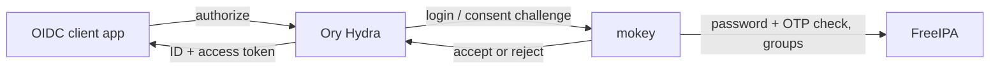

FreeIPA has no OpenID Connect provider of its own. mokey can serve as the
login and consent app for [Ory Hydra](https://www.ory.sh/hydra/): Hydra issues
the OAuth 2.0 and OIDC tokens, mokey signs the user in against FreeIPA and
decides which apps they may use, based on FreeIPA groups.



## What the user gets

- Signing in to any OIDC app shows the mokey login page, with the FreeIPA
  password and OTP code if two-factor is on. A user already signed in to mokey
  goes straight through. mokey does not show a separate consent screen; it
  grants the scopes the client asked for.
- **Security** tab: a list of connected apps (clients they have granted
  consent to, with scopes and when) and a **Revoke** button for each, which
  revokes that client's consent sessions in Hydra.
- Logging out of an app that uses OIDC logout ends the mokey session too and
  returns the user to the app's `post_logout_redirect_uri`.
- An app the user is not allowed into shows a 403 page from mokey.

## What the admin configures

In `mokey.toml`:

| Option | Default | Effect |
| --- | --- | --- |
| `hydra.admin_url` | — | Hydra admin API, e.g. `http://127.0.0.1:4445`. Setting it turns the integration on. |
| `hydra.login_timeout` | `0` | How long Hydra remembers the login, in seconds (`remember_for`). |
| `hydra.fake_tls_termination` | `false` | Send `X-Forwarded-Proto: https` to Hydra when TLS ends elsewhere. |
| `hydra.default_deny` | `false` | Deny clients that have neither a `[[hydra.clients]]` entry nor access set on the admin Apps page. |
| `hydra.manage_clients` | `false` | Admin page for OAuth clients ([below](#manage-clients-from-the-admin-page)). Needs `admin.enabled`. |
| `hydra.public_url` | — | Hydra's public URL as apps reach it, e.g. `https://auth.example.com`. Shown with new client secrets as issuer and endpoint URLs. |
| `[[hydra.clients]]` `client_id`, `groups` | — | Limit one client to members of FreeIPA groups. Repeat per client. |
| `hydra.consent_sweep_interval` | `1h` | How often to revoke consents of users removed from a client's groups directly in FreeIPA. `"0"` disables it. Each run stops early when no client is limited by config, the Apps page or `default_deny`. |
| `accounts.require_mfa` | `false` | Users without two-factor authentication are refused at login and consent. |

```toml
[hydra]
admin_url = "http://127.0.0.1:4445"
login_timeout = 86400
fake_tls_termination = true
default_deny = true

[[hydra.clients]]
client_id = "grafana"
groups = ["grafana-users", "admins"]

[[hydra.clients]]
client_id = "wiki"
groups = ["staff"]
```

In Hydra's config, point the login, consent and logout URLs at mokey:

```yaml
# hydra.yaml
urls:
  login: https://mokey.example.com/oauth/login
  consent: https://mokey.example.com/oauth/consent
  logout: https://mokey.example.com/auth/logout
  error: https://mokey.example.com/oauth/error
```

Register clients from the [admin Apps page](#manage-clients-from-the-admin-page),
or in Hydra itself (`hydra create oauth2-client ...`). A sample OIDC client is
in [examples/mokey-oidc](https://github.com/neverlless/mokey/tree/main/examples/mokey-oidc).
Coming from Hydra v1? See the [migration guide](../hydra-v2-migration.md).

## Manage clients from the admin page

Off by default. Turn it on with `hydra.manage_clients = true` (needs
`hydra.admin_url` and `admin.enabled`), and admins get **Administration >
Apps** (`/admin/apps`):

```toml
[hydra]
admin_url = "http://127.0.0.1:4445"
manage_clients = true
public_url = "https://auth.example.com"
```

The page lists every client in Hydra with its type and who may sign in. From
it an admin can:

- **Create** a client. The form takes a name, an app link, redirect URIs (one
  per line), optional post-logout redirect URIs, scopes and who may sign in.
  Choose a type:
  - **Web app**: a server-side app with a secret (`client_secret_basic`).
  - **Public**: a single-page, mobile or command-line app with no secret
    (`token_endpoint_auth_method=none`). Turn on `oauth2.pkce.enforced_for_public_clients`
    in Hydra's config so Hydra requires PKCE for them; mokey can't set it per
    client and doesn't check it.

  Both types get the `authorization_code` and `refresh_token` grants and the
  `code` response type. The type can't be changed later: create a new client
  instead. Leave the client ID empty to let Hydra generate one, or type one
  (lowercase letters, digits, `.`, `_` and `-`, up to 64, starting with a
  letter or digit). The ID can't be changed afterwards.
- **Edit** the name, link, redirect URIs, scopes, access and whether the app
  is shown in the [Apps catalog](app-catalog.md). Other Hydra fields of the
  client are left as they were.
- **Rotate the secret** of a web app. The old secret stops working at once.
- **Delete** a client. Hydra removes its consent sessions and tokens with it.

Redirect URIs must be absolute `https` URLs, or `http` for `localhost`,
`127.0.0.1` and `[::1]`; no fragments. Public clients may also use a
reverse-domain scheme such as `com.example.app:/callback`. Scopes offered are
`openid` (always), `profile`, `email`, `offline_access` and `ssh`, plus any
extra scopes typed into "Other scopes". Group names are checked against
FreeIPA when you save.

The client secret is shown once, on the page after create or rotate, with
copy buttons. mokey does not store it, log it or put it into audit lines or
webhooks; if it is lost, rotate it. With `hydra.public_url` set, that page
also lists the issuer, discovery, authorize and token URLs to paste into the
app; without it, only the client ID and secret appear.

Clients that only use `client_credentials` (machine to machine) are listed
as read-only. Manage them with the Hydra CLI:

```sh
hydra create oauth2-client \
  --endpoint http://127.0.0.1:4445 \
  --name "Backup job" \
  --grant-type client_credentials \
  --scope api
```

The same works for any other client type, if you prefer the CLI to the page:
clients created that way show up on the Apps page and can be edited there.
Clients with other grant or response types appear as editable too, but mokey
only changes the fields listed above.

Every change is an `AUDIT oauth client created|updated|secret rotated|deleted`
log line and a webhook event, naming the admin and the client but never the
secret.

### Who may sign in

Under **Who can sign in**, choose Everyone or members of chosen FreeIPA
groups. The choice is stored in the Hydra client's `metadata.mokey`
(`{"access": "groups", "groups": ["staff"], "catalog": true}`), so it
travels with the client. mokey decides in this order:

1. a `[[hydra.clients]]` entry for the client ID, if there is one;
2. the access set on the Apps page (`metadata.mokey`);
3. `hydra.default_deny`: open to everyone when `false`, denied when `true`.

"Everyone" on the Apps page admits every user even with `default_deny = true`.
A client whose `mokey` metadata is empty, or only sets `catalog`, falls back
to `default_deny`. Invalid `mokey` metadata denies the client.

Narrowing access (from Everyone to groups, or dropping a group) asks for
confirmation first. After saving, mokey revokes the consent sessions of users
who are no longer allowed, in the background; their tokens stop refreshing.

#### Clients set in mokey.toml

A client with a `[[hydra.clients]]` entry keeps its access in the file: the
page shows it read-only as "Set in mokey.toml". Everything else about it
(name, URIs, scopes, secret, delete) is editable. Each save also copies the
entry's groups into the client's metadata; the entry still wins while it
exists. To manage its access on the page instead, save once on this page,
then remove the entry from `mokey.toml` and restart mokey; access stays the
same. An entry for a client that doesn't exist in Hydra is
listed last, marked as not in Hydra.

### Claims

On consent mokey puts these claims into the ID token: `uid`,
`preferred_username`, `name`, `given_name` / `first`, `family_name` / `last`,
`email`, and `groups` (the user's FreeIPA groups).

A client that requests the `ssh` scope also gets `ssh_public_keys`: the
user's FreeIPA SSH public keys as `type base64 comment` lines, without
authorized_keys options, and an empty list for a user with no keys. Tick
`ssh` in the client's scopes on the Apps page (or add it in Hydra). Gitea can sync keys from it
(`gitea admin auth update-oauth --scopes ssh --ssh-public-key-claim-name
ssh_public_keys`); it updates them when the user signs in.

### Group rules

- A user must be a member of at least one group listed for the client, in
  `[[hydra.clients]]` or on the Apps page. Names compare case-insensitively,
  and membership through nested groups counts.
- A client with neither is open to every active FreeIPA user, unless
  `default_deny = true`.
- An unparseable `hydra.clients` value, or an entry without `client_id`,
  denies every client. An entry with no groups denies that client to
  everyone.
- A denied user's consent is rejected in Hydra with `access_denied`, but mokey
  shows its own 403 page instead of redirecting back, so clients that restart
  login on an error don't loop.

### When a user loses access

When a user leaves a group that admits them to a client, mokey revokes their
Hydra consent sessions for that client, so refresh tokens stop working:

- at once, when a sponsor removes them or approves their leave request in
  mokey;
- for removals made directly in FreeIPA, at the next sweep
  (`consent_sweep_interval`) or when the user next tries that client. The
  sweep runs whenever Hydra is configured; with no client limited it ends
  after one client-list call per interval.

## FreeIPA prerequisites

Nothing beyond the [service account](../install.md#1-create-the-service-account-in-freeipa):
mokey reads users and groups with it. Hydra itself runs separately, with its
own database; see the [Hydra documentation](https://www.ory.sh/docs/hydra/).

## Limits

- mokey is not an identity provider by itself. It issues no tokens and has no
  OIDC endpoints; without Hydra there is no OIDC.
- No SAML. For SAML-only apps, put Keycloak in front as a broker: see
  [mokey next to Keycloak](../keycloak.md).
- The `groups` claim lists direct groups only, while the access check counts
  nested ones. An app that checks the claim itself can refuse a user mokey let
  through.
- Clients registered with `skip_consent: true` never reach mokey's consent
  endpoint, so group rules do not apply to them.
- Until the sweep runs, a user removed in FreeIPA keeps working tokens, and an
  app that validates JWT access tokens itself accepts them until they expire.
- No consent screen and no per-scope choice for the user.
