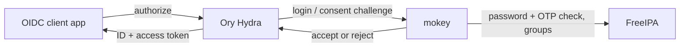

# FreeIPA OpenID Connect SSO with Ory Hydra

FreeIPA has no OpenID Connect provider of its own. mokey can serve as the
login and consent app for [Ory Hydra](https://www.ory.sh/hydra/): Hydra issues
the OAuth 2.0 and OIDC tokens, mokey signs the user in against FreeIPA and
decides which apps they may use, based on FreeIPA groups.



## What the user gets

- Signing in to any OIDC app shows the mokey login page, with the FreeIPA
  password and OTP code if two-factor is on. A user already signed in to mokey
  goes straight through. mokey does not show a separate consent screen; it
  grants the scopes the client asked for.
- **Security** tab: a list of connected apps (clients they have granted
  consent to, with scopes and when) and a **Revoke** button for each, which
  revokes that client's consent sessions in Hydra.
- Logging out of an app that uses OIDC logout ends the mokey session too and
  returns the user to the app's `post_logout_redirect_uri`.
- An app the user is not allowed into shows a 403 page from mokey.

## What the admin configures

In `mokey.toml`:

| Option | Default | Effect |
| --- | --- | --- |
| `hydra.admin_url` | — | Hydra admin API, e.g. `http://127.0.0.1:4445`. Setting it turns the integration on. |
| `hydra.login_timeout` | `0` | How long Hydra remembers the login, in seconds (`remember_for`). |
| `hydra.fake_tls_termination` | `false` | Send `X-Forwarded-Proto: https` to Hydra when TLS ends elsewhere. |
| `hydra.default_deny` | `false` | Deny clients that have no `[[hydra.clients]]` entry. |
| `[[hydra.clients]]` `client_id`, `groups` | — | Limit one client to members of FreeIPA groups. Repeat per client. |
| `hydra.consent_sweep_interval` | `1h` | How often to revoke consents of users removed from a client's groups directly in FreeIPA. `"0"` disables it. Runs only when `[[hydra.clients]]` or `default_deny` is set. |
| `accounts.require_mfa` | `false` | Users without two-factor authentication are refused at login and consent. |

```toml
[hydra]
admin_url = "http://127.0.0.1:4445"
login_timeout = 86400
fake_tls_termination = true
default_deny = true

[[hydra.clients]]
client_id = "grafana"
groups = ["grafana-users", "admins"]

[[hydra.clients]]
client_id = "wiki"
groups = ["staff"]
```

In Hydra's config, point the login, consent and logout URLs at mokey:

```yaml
# hydra.yaml
urls:
  login: https://mokey.example.com/oauth/login
  consent: https://mokey.example.com/oauth/consent
  logout: https://mokey.example.com/auth/logout
  error: https://mokey.example.com/oauth/error
```

Register clients in Hydra as usual (`hydra create oauth2-client ...`). A
sample OIDC client is in
[examples/mokey-oidc](https://github.com/neverlless/mokey/tree/main/examples/mokey-oidc).
Coming from Hydra v1? See the [migration guide](../hydra-v2-migration.md).

### Claims

On consent mokey puts these claims into the ID token: `uid`,
`preferred_username`, `name`, `given_name` / `first`, `family_name` / `last`,
`email`, and `groups` (the user's FreeIPA groups).

### Group rules

- A user must be a member of at least one group listed for the client. Names
  compare case-insensitively, and membership through nested groups counts.
- A client without an entry is open to every active FreeIPA user, unless
  `default_deny = true`.
- An unparseable `hydra.clients` value, or an entry without `client_id`,
  denies every client. An entry with no groups denies that client to
  everyone.
- A denied user's consent is rejected in Hydra with `access_denied`, but mokey
  shows its own 403 page instead of redirecting back, so clients that restart
  login on an error don't loop.

### When a user loses access

When a user leaves a group that admits them to a client, mokey revokes their
Hydra consent sessions for that client, so refresh tokens stop working:

- at once, when a sponsor removes them or approves their leave request in
  mokey;
- for removals made directly in FreeIPA, at the next sweep
  (`consent_sweep_interval`) or when the user next tries that client.

## FreeIPA prerequisites

Nothing beyond the [service account](../install.md#1-create-the-service-account-in-freeipa):
mokey reads users and groups with it. Hydra itself runs separately, with its
own database; see the [Hydra documentation](https://www.ory.sh/docs/hydra/).

## Limits

- mokey is not an identity provider by itself. It issues no tokens and has no
  OIDC endpoints; without Hydra there is no OIDC.
- No SAML. For SAML-only apps, put Keycloak in front as a broker: see
  [mokey next to Keycloak](../keycloak.md).
- The `groups` claim lists direct groups only, while the access check counts
  nested ones. An app that checks the claim itself can refuse a user mokey let
  through.
- Clients registered with `skip_consent: true` never reach mokey's consent
  endpoint, so group rules do not apply to them.
- Until the sweep runs, a user removed in FreeIPA keeps working tokens, and an
  app that validates JWT access tokens itself accepts them until they expire.
- No consent screen and no per-scope choice for the user.
