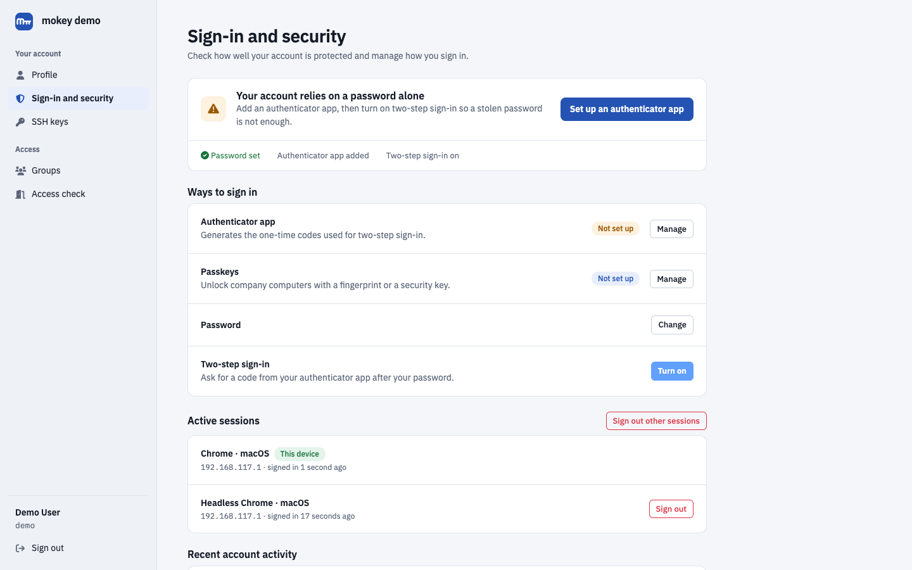

FreeIPA supports OTP two-factor authentication, but users normally need the
FreeIPA Web UI or an administrator to add a token. mokey lets users enroll
TOTP tokens in an authenticator app, turn two-factor authentication on and
off, and ask for help when they lose their only token. Tokens live in
FreeIPA, so they work for SSH, sudo and Kerberos logins on enrolled hosts,
not just for mokey.



## What the user gets

- **OTP Tokens** tab: add a TOTP token by scanning a QR code, confirm it with
  a code from the app (a token that is never confirmed is removed), and
  remove, enable or disable tokens.
- **Security** tab: a **Two-Factor Authentication** switch. Turning it on
  needs at least one token and sets the account's FreeIPA authentication type
  to `otp` (password plus code). Turning it off clears the user's own
  authentication types, so the server-wide default applies again.
- An email whenever a token is added or removed and whenever two-factor
  authentication is switched on or off.
- **Lost OTP token?** on the login page: the user confirms the request through
  an emailed link, and it lands in the admin panel's **OTP recovery requests**
  queue. Approval switches the account to password-only sign-in so the user
  can log in and enroll a new token. Their old tokens stay in place. Every
  answer is the same whether or not the account exists or uses OTP.
- Login asks two-factor users for the OTP code in its own field next to the
  password, or, with
  `accounts.single_page_login`, appended to the password the way FreeIPA
  expects (`password123456`).

## What the admin configures

| Option | Default | Effect |
| --- | --- | --- |
| `accounts.otp_issuer` | FreeIPA default | Issuer name shown in authenticator apps. |
| `accounts.otp_hash_algorithm` | `sha1` | `sha1`, `sha256` or `sha512` for new tokens. Some authenticator apps only support `sha1`. |
| `accounts.otp_readonly_groups` | empty | Members of these FreeIPA groups see their tokens read-only: no enrollment, removal, or enable/disable. For hardware tokens issued centrally. Enforced server-side. |
| `accounts.require_mfa` | `false` | Users without two-factor authentication are prompted to enroll and cannot manage SSH keys. With Hydra, they are also refused at OIDC consent. |
| `admin.enabled` | `false` | Needed to see and approve OTP recovery requests. |
| `storage.driver` | `memory` | Recovery requests are queued in mokey's storage; with `memory` they are lost on restart. |

```toml
[accounts]
otp_issuer = "Example Corp"
otp_readonly_groups = ["hw-token-users"]
require_mfa = true

[admin]
enabled = true
```

## FreeIPA prerequisites

- Token enrollment, removal and enable/disable run with the user's own
  FreeIPA session. FreeIPA lets users manage their own tokens by default.
- Switching two-factor on and off and approving recovery are done by the
  service account. Its role needs `ipauserauthtype` in the
  `System: Modify Users` permission:
  `ipa permission-mod 'System: Modify Users' --includedattrs=ipauserauthtype`
  (part of [Install](../install.md#1-create-the-service-account-in-freeipa)).

## Limits

- Only TOTP tokens can be enrolled from mokey. HOTP and hardware tokens are
  added by an administrator in FreeIPA; use `otp_readonly_groups` to stop
  users from removing them.
- Recovery needs a human: an administrator approves each request. There are
  no backup codes.
- Recovery leaves the account on password-only sign-in until the user turns
  two-factor authentication back on. With `require_mfa` they are prompted to.
- The two-factor switch sets the user's own authentication type. If you
  enforce OTP through the server-wide default (`ipa config-mod
  --user-auth-type=otp`), the switch does not override that.
