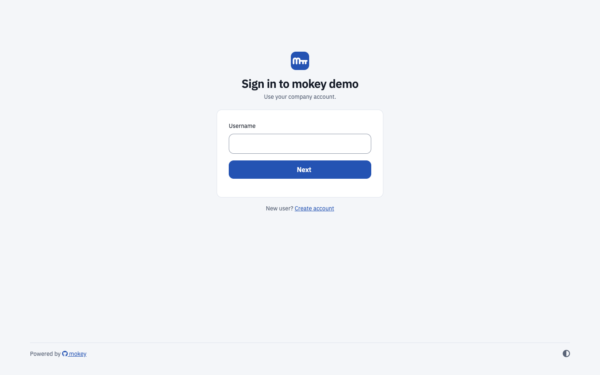

# FreeIPA self-service password reset portal

FreeIPA has no "forgot password" flow of its own. mokey adds one: a user
enters their username, gets a single-use link by email, and sets a new
FreeIPA password that works at once, with no forced change at next login.

## What the user gets

- **Forgot password** on the login page (`/auth/forgotpw`): username and a
  CAPTCHA. The page always says the same thing, whether or not the account
  exists, so it cannot be used to find usernames.
- An email with a reset link. If `[slack]` is configured, the same link also
  arrives as a Slack direct message to the user matched by email address.
- A reset page that lists the FreeIPA password policy that applies to them.
  Users with two-factor authentication also enter a current OTP code.
- After the reset, every mokey session of that user is signed out.
- **Forgot username** (`/auth/forgotuser`): emails the usernames registered
  to an address, again with the same answer for unknown addresses.
- Signed-in users change their password on the **Password** tab, with a
  "password expires in N days" banner when expiry is near. A user whose
  password has expired is asked to change it at login.

## What the admin configures

Nothing has to be enabled; the flow is on whenever mokey runs. The options
that shape it:

| Option | Default | Effect |
| --- | --- | --- |
| `email.token_max_age` | `3600` | Lifetime of a reset link, in seconds. A link works once. |
| `email.token_secret` | auto | Signs the links. Set it, or links die on restart. |
| `email.resend_cooldown` | `180` | Seconds before the same user can be sent another reset email. |
| `email.base_url` | request host | Host used in the link. Set it behind a proxy. |
| `email.notify_password_change` | `false` | Email the user after a change or reset. |
| `email.password_expiry_reminders` | empty | Days before expiry to send reminder emails, e.g. `[14, 7, 3, 1]`. |
| `accounts.enable_captcha` | `true` | CAPTCHA on the forgot-password form. |
| `accounts.min_passwd_len`, `accounts.min_passwd_classes` | `8`, `2` | Floors; the stricter of these and the FreeIPA policy wins. |
| `accounts.check_breached_passwords` | `false` | Refuse passwords found in Have I Been Pwned (k-anonymity range API). |
| `accounts.password_expiry_warning_days` | `14` | When the expiry banner appears. |
| `accounts.block_users` | — | Usernames that can never log in or get a reset email. |
| `server.rate_limit_max`, `server.rate_limit_expiration` | `10`, `3600` | Failed requests allowed per client per window. |

Admins with the [admin panel](../configuration.md#admin) enabled can also
send a reset email to any user from the user list.

## FreeIPA prerequisites

- The service account role from [Install](../install.md#1-create-the-service-account-in-freeipa):
  the **User Administrators** privilege resets the password,
  **Password Policy Readers** lets mokey show and check the policy.
- Every user who should be able to reset needs an email address in FreeIPA.
- Outbound SMTP from mokey.

mokey sets the new password in two steps: an administrative reset to a
random value, then a change from that value to the user's choice through
FreeIPA's own password-change endpoint. Because the last change is the
user's own, FreeIPA does not mark the password as expired.

## Limits

- Email is the only channel (plus Slack, if configured). There are no
  security questions and no SMS.
- A reset link proves control of the mailbox, nothing more. Anyone who can
  read a user's email can take over that FreeIPA account. Two-factor users
  still need their OTP code.
- Users who sign in through an external identity provider, RADIUS, or with
  a smart card or passkey only have no FreeIPA password to reset. They get an
  email explaining where their password is managed instead of a link.
  Trusted Active Directory usernames (`user@ad.example.com`, `AD\user`) are
  told to change their password in Active Directory. See
  [Users without a FreeIPA password](../configuration.md#users-without-a-freeipa-password).
- Locked or disabled accounts get no link, and the page does not say so.
- FreeIPA's dictionary check (`dictcheck`) only runs inside FreeIPA, so mokey
  cannot show it in advance; a password it rejects is reported after submit.
