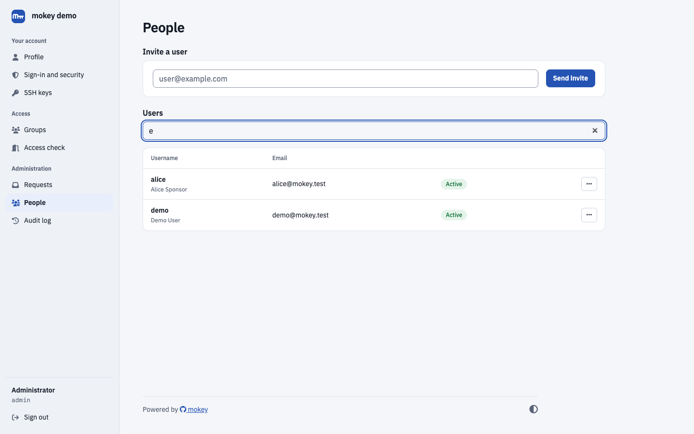

# FreeIPA self-service user signup (registration portal)

FreeIPA has no public registration page. mokey adds one: people create their
own FreeIPA account, confirm their email address, and optionally wait for an
administrator to approve them. Unapproved registrations can be kept out of the
active user tree entirely by creating them as FreeIPA stage users.



## What the user gets

- **Create Account** on the login page (`/signup`): first and last name,
  email, username (or one derived from the email), password, CAPTCHA, and a
  link to your terms of service if you set one.
- A verification email. Opening the link activates the account, or, with
  admin approval on, tells the user the account is waiting for approval.
- A welcome email once the account is usable, with links to your help and
  getting-started pages.
- **Resend verification** (`/auth/verify`) if the email got lost.
- People invited by an administrator get a link to a pre-verified signup
  form; their account is active as soon as they submit it.

## What the admin configures

| Option | Default | Effect |
| --- | --- | --- |
| `accounts.enable_signup` | `true` | Turns `/signup` and the "Create Account" link on or off. |
| `accounts.require_admin_verify` | `false` | After email verification the account stays locked until an admin approves it. Approval sends the welcome email; denial deletes the registration. |
| `accounts.staged_signup` | `false` | Create signups as FreeIPA stage users (`stageuser_add`) and activate them (`stageuser_activate`) on verification or approval. |
| `accounts.allowed_domains` | — | Only these email domains may sign up, each with a username generator: `default` (local part) or `flast` (first initial + last name). |
| `accounts.username_from_email` | `false` | Derive the username from the email address instead of asking. |
| `accounts.default_homedir`, `accounts.default_shell` | `/home`, `/bin/bash` | Home directory base and shell for new accounts. |
| `accounts.enable_captcha` | `true` | CAPTCHA on signup and verification-resend forms. |
| `email.token_max_age` | `3600` | Lifetime of the verification link, in seconds. |
| `site.tos_url`, `site.help_url`, `site.getting_started_url` | — | Links shown on the signup page and in the welcome email. |
| `admin.enabled`, `admin.group`, `admin.users` | `false`, `admins` | The admin panel, where pending approvals and invitations live. |

Example: registrations from two domains, held as stage users until an admin
approves them:

```toml
[accounts]
enable_signup = true
require_admin_verify = true
staged_signup = true
allowed_domains = {"example.edu" = "default", "example.com" = "flast"}

[admin]
enabled = true
group = "admins"
```

The admin panel's **Pending approval** queue shows verified registrations
waiting for a decision. **Invite a user** sends a signup link to an email
address.

## FreeIPA prerequisites

- **User Administrators** (creating and enabling users) and the
  **Mokey UPG Read** privilege from
  [Install](../install.md#1-create-the-service-account-in-freeipa).
- **Stage User Administrators**, only with `staged_signup = true`.
- Password policy: mokey checks the global FreeIPA policy before creating
  the account, so users see a policy error on the form instead of a half-made
  account.

## How the two modes differ

**Default (`staged_signup = false`).** mokey creates an active user, marks it
with the user class `mokey-user-unverified` and disables it. Verification
enables it (or leaves it locked for approval). Until then the account exists
in the active tree as a disabled user, so it takes the username and shows up
in `ipa user-find`.

**Staged (`staged_signup = true`).** mokey creates a stage user. Nothing
appears in the active tree until verification (and approval, if required)
activates it; denial deletes the stage entry. FreeIPA expires the password
on activation; mokey lifts that expiry so the password chosen at signup works
on the first login. `stageuser_add` applies no password policy, so mokey
checks it itself, including the FreeIPA 4.13 rules; FreeIPA's dictionary
check (`dictcheck`) does not apply to staged signups.

## Limits

- Spam protection is the CAPTCHA, the domain allow-list and the rate limiter.
  There is no external spam scoring.
- Registrations that are never verified are not cleaned up automatically. In
  the default mode they stay as disabled users; in staged mode, as stage
  users.
- Signup collects first name, last name, email, username and password only.
  There are no custom fields or agreements to accept.
- Pending-approval notifications are not emailed to admins; they check the
  queue in the admin panel.
