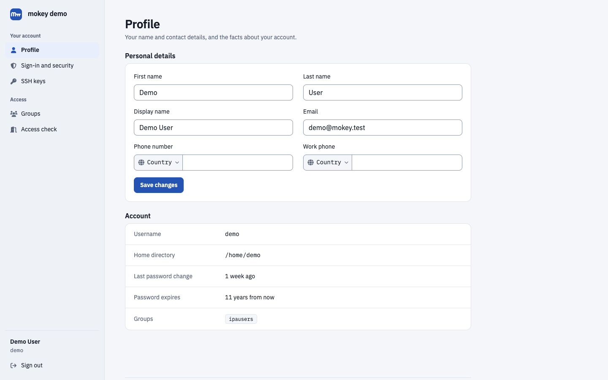

# mokey: self-service portal for FreeIPA

mokey is a self-service account portal for FreeIPA and Red Hat Identity
Management (IdM). Users sign up, reset forgotten passwords, enroll OTP tokens
and passkeys, manage SSH keys, ask to join groups and see which hosts they can
log in to, all without access to the FreeIPA Web UI. mokey is a standalone Go
application that talks to the FreeIPA JSON-RPC API with a least-privilege
service account. It needs no LDAP schema changes and no database of its own.
It can also serve as the login and consent app for Ory Hydra (OAuth 2.0 /
OpenID Connect).

## Find the guide for your task

| You want to... | Guide |
| --- | --- |
| Try mokey or install it | [Install](install.md) |
| Let users reset forgotten FreeIPA passwords | [Self-service password reset](guides/password-reset.md) |
| Let people create their own FreeIPA accounts, with or without admin approval | [User signup](guides/signup.md) |
| Let users enroll TOTP tokens and recover from a lost one | [OTP tokens](guides/otp.md) |
| Let users register FIDO2 passkeys in FreeIPA | [Passkeys](guides/passkeys.md) |
| Sign in to web apps with FreeIPA accounts over OpenID Connect | [OIDC / SSO with Ory Hydra](guides/oidc-hydra.md) |
| Let group owners approve membership requests | [Group self-service](guides/groups.md) |
| Show users which HBAC and sudo rules apply to them | [Access page](guides/access.md) |
| Keep your existing OIDC provider and add mokey for account lifecycle | [Next to any OIDC provider](companion/oidc-provider.md) |
| Serve SAML-only apps | [Next to Keycloak](keycloak.md) |
| Choose between mokey, noggin, LTB Self Service Password and Keycloak | [Comparisons](comparison.md) |
| Look up a configuration option | [Configuration reference](configuration.md) |

## Why a separate portal

FreeIPA does not ship self-service signup or password reset, by design (see
[the FreeIPA rationale](https://www.freeipa.org/page/Self-Service_Password_Reset)).
By default any authenticated user can also browse every account in the
FreeIPA Web UI. mokey shows users only their own account and leaves the Web UI
to administrators.

Self-service password reset widens your attack surface. Read
[Operating mokey safely](https://github.com/neverlless/mokey/blob/main/SECURITY.md#operating-mokey-safely)
before you expose mokey to the internet.
